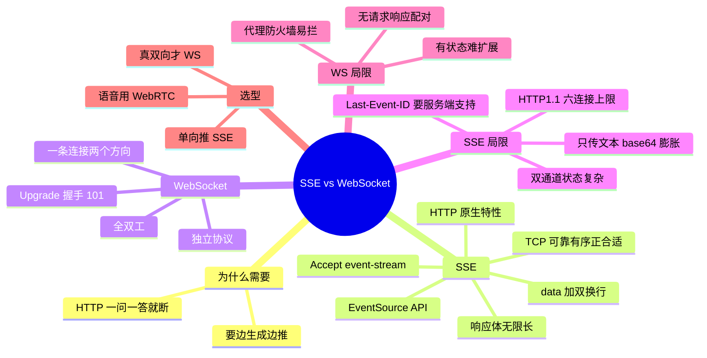

## 🔥 快速背诵

SSE 是 HTTP 原生的单向水管，服务端往下推，客户端不用问；WebSocket 是 HTTP 升级之后的全双工电话，两边随时能说。SSE 的局限是只能单向、只能传文本、每个连接占一个 HTTP；WS 的代价是要维护连接状态、容易被中间层拦、配置更麻烦。但 LLM 的文字输出天然单向流式，所以 OpenAI、Anthropic 的 API 都用 SSE。

> **一句话**：**SSE 是 HTTP 原生的单向水管，WebSocket 是升级后的全双工电话**。LLM 文字输出单向推就够——所以 OpenAI/Anthropic 都用 SSE。

## 🧠 导图



---

# 📖 背诵稿

> 五段，按顺序背。

### ① 问题起点

**标准 HTTP 是一问一答，答完就断，服务端不能主动推。**

模型生成一段回答要几秒十几秒，全生成完再返回，用户只能瞪着白屏。我们想要的是生成一个词推一个词，像 ChatGPT 那样一个字一个字打出来——这就要连接保持打开、服务端持续往外写，HTTP 原本做不到。

### ② SSE 是什么

**SSE 不是新协议，是 HTTP/1.1 本来就有的特性，本质是把一条 HTTP 响应「撑成」单向水管。**

客户端发一个普通 GET，请求头里声明 `Accept: text/event-stream`；服务端不关连接，一直往里写。响应体在技术上是「无限长」的，直到生成完毕才发结束标志。数据格式很简单：每行以 `data:` 开头，后面是内容，末尾两个换行，浏览器有 `EventSource` 直接处理，注册 `onmessage` 就自动触发。它成为 LLM 流式标准还有一个关键原因：**文字必须准确有序，这恰好是 TCP 的强项**——你愿意等重传，因为等来的是正确内容。

### ③ WebSocket 是什么

**WebSocket 是独立协议，握一次手就从 HTTP「变性」成全双工信道。**

客户端先发一个看起来像普通 HTTP 的请求，头里带「我想升级」，服务端同意就回 `101 Switching Protocols`，此刻起这条 TCP 连接不再遵循一问一答，双方都能随时说话。类比：从对讲机升级成电话。最本质的区别是方向——SSE 只有服务端能推，客户端要发消息得另起请求；WebSocket 一条连接搞定两个方向。感受一下差异：用户想中途打断模型，SSE 得先关流再发 POST，中间有明显断层；WebSocket 直接在同一条连接里发「停止」，无缝。

### ④ SSE 的坑

**除了单向，SSE 还有三个真实的坑。**

一是 HTTP/1.1 同域名只有 6 条连接上限，SSE 占一条长连接，用户开多个标签页，第 7 个就被排队，表现为「页面卡死」；HTTP/2 多路复用能解决，但老浏览器和不支持的代理环境仍是坑。二是只能传文本，音频图片要先 Base64，数据膨胀约 33%，还要额外解码，实时语音完全不可接受。三是单向导致的双通道尴尬：发消息走 POST、收回复走 SSE，靠 conversation ID 关联，状态管理更复杂、排查链路更长。另外断线重连要靠 `Last-Event-ID` 做「接着上次继续」，很多实现省了这块，断线后就丢中间内容。

### ⑤ WebSocket 的坑与选型

**WebSocket 的三个坑都来自「有状态」。**

连接建立时被负载均衡路由到某台后端，之后这个用户所有消息都得发到同一台，因为连接状态在那。扩容时新机器接不到老连接，用户迁不过去，扩容效果打折；常见解法是把状态外移到 Redis 做发布订阅中转，但架构更复杂、多一跳延迟。第二是代理和防火墙穿透，很多企业代理、老 CDN 不认 Upgrade 握手，直接当异常请求拒掉；SSE 始终是普通 HTTP，任何代理都能透传——这也是早期 MCP 远程选 SSE 的原因。第三是 WebSocket 没有内置的请求-响应配对，得自己在消息里加请求 ID、维护映射表，断线重连时这些等待中的请求怎么处理还要专门设计。选型原则一句话：**单向推用 SSE，真需要双向才上 WebSocket，实时语音用 WebRTC**。

---

# 🔑 记忆锚

| 记什么 | 内容 | 口诀 |
|---|---|---|
| **2** 个方向 | SSE 单向 / WS 全双工 | 「水管·电话」 |
| **3** 个 SSE 坑 | 6 连接上限 / 只传文本 / 双通道 | 「限·文·双」 |
| **3** 个 WS 坑 | 有状态难扩 / 代理易拦 / 无配对 | 「态·拦·配」 |
| **1** 句选型 | 单向推 SSE，双向才 WS | 「不双向不上 WS」 |

> **卡壳急救**：先答方向差异（水管 vs 电话），再各报三个坑，最后落到选型原则。

---

# 🎯 追问速查

| 面试官问 | 你答 |
|---|---|
| AI 流式为什么用 SSE 不用 WS？ | 单向推就够，轻量、HTTP 原生、代理友好、运维简单 |
| SSE 是 WebSocket 的子集吗？ | **不是**。SSE 是 HTTP 特性，WS 是独立协议，底层机制不同 |
| 6 连接上限怎么破？ | HTTP/2 多路复用；或控制并发 SSE、使用子域名 |
| 为什么语音不用 SSE/WS？ | TCP 重传会导致不可接受延迟，要用 UDP（WebRTC） |
| 用户中途打断怎么办？ | WS 更顺；SSE 需关流 + 再发请求 |
| WS 怎么做请求-响应配对？ | 消息带请求 ID，客户端维护映射表；重连需重试设计 |
| SSE 断线会丢内容吗？ | 默认可能丢；要服务端支持 `Last-Event-ID` 重放 |
| 多人在线协同选哪个？ | WebSocket，高频双向消息，SSE+POST 太繁琐 |

---

# 🔗 串联

- 上游 → **13（MCP 传输）**：MCP 远程的流式底层就是 SSE
- 下游 → **15（WebRTC vs WS）**：语音为什么要换 UDP
- 大模型工程 → 呼应 **部署方案（20）**里的网关与流式接入
- 收尾金句：**文字要可靠，所以信 TCP；语音要实时，所以弃 TCP**

---

# 📚 细节（背完再点开）

> [!note]- 场景选型表
> | 场景 | 方案 | 原因 |
> |---|---|---|
> | LLM 流式文字 | SSE | 单向够用、轻量、运维简单 |
> | 多轮对话 | SSE + POST | 发消息走 POST，回复走 SSE |
> | 用户中途打断 | WebSocket | 需要客户端在生成中主动发消息 |
> | 多人协同编辑 | WebSocket | 高频双向 |
> | 实时语音 | WebRTC | UDP 低延迟 |
> | MCP 远程 Server | Streamable HTTP（内部 SSE） | 代理穿透友好 |

> [!note]- SSE 消息长什么样
> ```
> data: {"token":"你"}
> <空行>
> data: {"token":"好"}
> <空行>
> ```
> 打开 ChatGPT 按 F12 看 Network 里的流式请求，就是这种一行一行追加的文本。

---

# 🎴 自测

> [!question]- Q1 最本质的区别？
> 通信方向：SSE 服务端单向推，WebSocket 全双工。

> [!question]- Q2 SSE 的三个坑？
> 连接数上限、只能传文本、双通道状态复杂。

> [!question]- Q3 WebSocket 的三个坑？
> 有状态难横向扩展、代理防火墙易拦、没有请求响应配对。

> [!question]- Q4 为什么 LLM 都用 SSE？
> 文字是单向推，且 TCP 可靠有序正合适；SSE 轻量、代理友好。

> [!question]- Q5 什么时候必须 WebSocket？
> 需要客户端在生成过程中主动发消息，如实时打断、多人协同。
