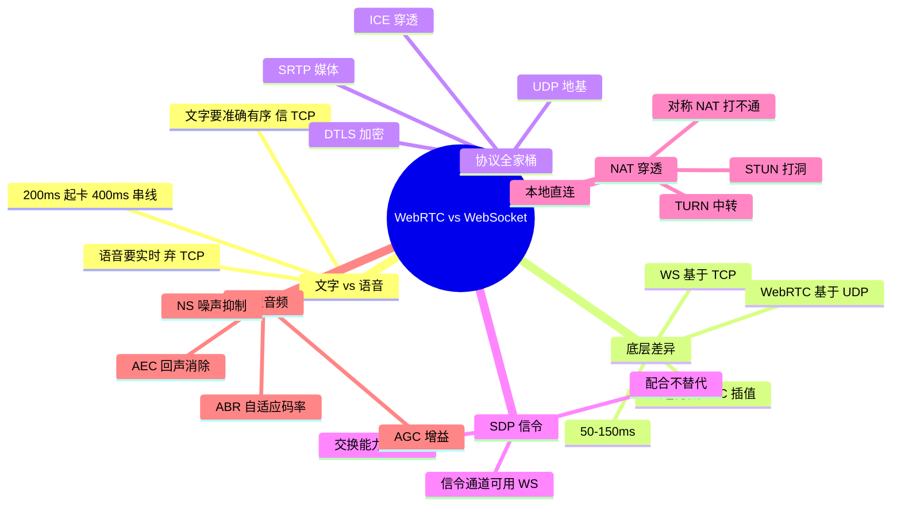

## 🔥 快速背诵

语音的铁律是容忍丢包，绝不容忍延迟。WebSocket 跑在 TCP 上，丢一个 20 毫秒的语音帧就得等重传，后面全堵住，听起来就是卡顿和变声；WebRTC 跑在 UDP 上，丢了用前后帧插值补一下，人耳基本听不出来。而且 WebRTC 内置回声消除、降噪、自动增益，还有抖动缓冲和自适应码率。所以实时语音用 WebRTC，纯文本推送用 WS 或 SSE。

> **一句话**：**语音容忍丢包，绝不容忍延迟**。WS 走 TCP，丢一个 20ms 帧就要等重传，后面全堵；WebRTC 走 UDP，丢了用插值补——还内置一整套音频处理。

## 🧠 导图

---

# 📖 背诵稿

> 五段，按顺序背。

### ① 文字和语音的要求相反

**文字传输要准确有序，语音传输要低延迟——这两个需求指向完全不同的底层协议。**

传文字时丢一个字母整段话就变味，顺序乱了没法读，所以你愿意等 TCP 重传，等来的是正确内容。但语音反过来：人脑对时序极其敏感，超过 200ms 就明显卡，超过 400ms 就开始「说话串线」。丢一个 20ms 的音频片段人耳根本察觉不到，可为了等它重传把后面全堵住，延迟累积到几百毫秒体验就崩了。一句话：**语音容忍丢包，绝不容忍延迟**。WebSocket 底层是 TCP，天然带着这个问题。

### ② WebRTC 的根本选择

**WebRTC 最核心的设计决策是把底层从 TCP 换成 UDP，主动放弃可靠性。**

UDP 发了就不管，丢了不重传。听起来不可靠，但对语音恰恰正确：WebRTC 在 UDP 之上自己做了「丢包隐藏」，某帧丢了就用前后帧插值生成一段听起来合理的音频顶上去，整体播放不中断，只有极短暂的音质轻微下降。这是典型的工程权衡——**用偶尔的音质损失换稳定的低延迟**，端到端能压在 50~150ms。

### ③ 它不是单一协议

**WebRTC 更像一个协议全家桶，在 UDP 之上叠了好几层。**

最底层 UDP 负责低延迟，这是地基。上面跑 DTLS，相当于「UDP 版的 TLS」，负责密钥协商和加密，因为 UDP 没有现成的 TLS 握手。加密通道建好后，媒体用 SRTP 传——RTP 专门为实时媒体设计，每个包带时间戳和序列号，接收方知道它该排在哪、前面有没有丢，配合 RTCP 做质量监控和反馈。连接建立阶段用 ICE 框架处理 NAT 穿透，这是部署中最复杂的部分。

### ④ 信令与穿透

**建连前双方要互相告知能力，这个协商用 SDP，而 SDP 的交换还需要一条信令通道——通常就是 WebSocket。**

SDP 只是一种格式，不规定怎么传。双方要交换「我支持哪些编解码、我的网络地址、加密参数」，这个通道可以是 WS、HTTP 或任何双向方式。**所以做 AI 语音时还是需要 WebSocket：它负责信令，音频流走 WebRTC 的 UDP 通道，两者配合不替代。** 穿透靠 ICE 三级降级：同局域网直接内网连；否则用 STUN 发现公网 IP 和端口尝试「打洞」；打不通（典型是对称 NAT，每个目标分配不同出口端口）就走 TURN 服务器中转，失去 P2P 延迟优势但至少通。

### ⑤ 内置音频能力

**用 WS 做语音最难补的，是 WebRTC 内置的那一整套音频处理。**

回声消除 AEC 最重要：外放时麦克风会把 AI 的声音也收进去，不处理就形成反馈循环。噪声抑制 NS 过滤咖啡厅这类环境噪声只留人声。自动增益 AGC 让音量稳定，小的放大、大的降低。自适应码率 ABR 通过 RTCP 监测网络，好时高码率保音质、差时降码率保流畅。这些用 WebSocket 全得自己造轮子。所以 OpenAI Realtime API 选 WebRTC：端到端延迟要低于 300ms、双向同时流动、随时可打断、还要消回声——只有 WebRTC 全满足。

---

# 🔑 记忆锚

| 记什么 | 内容 | 口诀 |
|---|---|---|
| **1** 条铁律 | 语音容丢包，不容延迟 | 「丢得起，等不起」 |
| **4** 层协议 | UDP / DTLS / SRTP / ICE | 「基·密·媒·通」 |
| **3** 级穿透 | 直连 / STUN 打洞 / TURN 中转 | 「直·洞·转」 |
| **4** 项音频能力 | AEC / NS / AGC / ABR | 「回·噪·音·码」 |

> **卡壳急救**：先答 TCP vs UDP 和那条铁律，再补协议栈、信令、音频能力。

---

# 🎯 追问速查

| 面试官问 | 你答 |
|---|---|
| WS 和 WebRTC 都能传语音，差别不大？ | 差别是根本性的：TCP 重传 vs UDP 丢包隐藏 |
| P2P 是核心原因吗？ | 只是特点之一。核心是底层协议与延迟策略 |
| WebRTC 用什么替代重传？ | 丢包隐藏（PLC），用前后帧插值填补 |
| 用了 WebRTC 还要 WebSocket 吗？ | 要。WS 做 SDP 信令交换，媒体走 WebRTC |
| 为什么打洞会失败？ | 对称 NAT 每个目标分配不同出口端口，STUN 探测的端口失效 |
| TURN 的代价？ | 流量中转，失去 P2P 延迟优势，且要自建或买服务 |
| 为什么 OpenAI Realtime 选 WebRTC？ | 延迟要求 <300ms + 双向 + 可打断 + 消回声，TCP 系方案顶不住 |
| 实现复杂度在哪？ | 信令服务器、STUN/TURN 部署运维 |

---

# 🔗 串联

- 上游 → **14（SSE vs WS）**：文字场景的取舍
- 语音 AI → 呼应 **实时语音对话链路**（ASR → LLM → TTS）与打断机制
- 工程取舍 → 呼应 **延迟优化 / Trace 定位**（Agent 第 21 篇）
- 收尾金句：**文字求准，语音求快，协议各自服务场景**

---

# 📚 细节（背完再点开）

> [!note]- 对照表
> | 维度 | WebSocket | WebRTC |
> |---|---|---|
> | 底层 | TCP | UDP |
> | 连接 | C↔S | P2P（可降级 TURN） |
> | 延迟 | 50~500ms | 50~150ms |
> | 丢包 | 强制重传阻塞 | 插值填补不阻塞 |
> | 音视频 | 无，需自建 | 原生（编解码 + AEC/NS/AGC/ABR） |
> | 建连 | Upgrade 即可 | 信令 + ICE 穿透 |
> | 复杂度 | 低 | 高（信令 + STUN/TURN） |

> [!note]- 一次 AI 语音通话的完整链路
> 浏览器采集 → WebRTC（UDP/SRTP）→ 服务端 ASR → LLM → TTS → WebRTC 回传
> 同时 WebSocket 承担：SDP 协商、控制指令（打断、挂断）、事件通知。

---

# 🎴 自测

> [!question]- Q1 那条铁律？
> 语音容忍丢包，绝不容忍延迟。

> [!question]- Q2 为什么 TCP 在语音里是灾难？
> 丢包强制重传，后续音频全部等待，延迟累积到几百毫秒通话就崩。

> [!question]- Q3 WebRTC 怎么处理丢包？
> 丢包隐藏 PLC，用前后帧插值填补，不重传不阻塞。

> [!question]- Q4 为什么还需要 WebSocket？
> 交换 SDP 信令；媒体流才走 WebRTC。

> [!question]- Q5 ICE 三级降级？
> 本地直连 → STUN 打洞 → TURN 中转。
