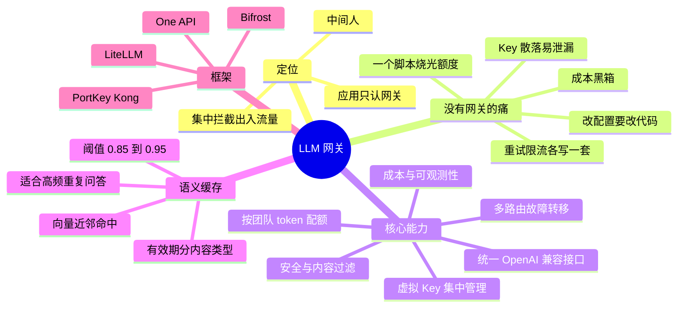

## 🔥 快速背诵

LLM 网关就是应用和模型 API 之间的中间人，把散落在各处的横切关注点收拢到一处。六件事：统一接口，屏蔽各家 SDK 差异；Key 集中管理，虚拟 Key 分发给业务方；配额和限流，防止某个业务把额度刷爆；成本追踪，按业务按模型算钱；安全过滤，敏感词和内容审核；语义缓存，相同意图的请求直接命中。工具一多、模型一多，网关就从可以没有变成必须有。

> **一句话**：网关是应用与模型 API 之间的**中间人**，把散落的「横切关注点」集中起来——**统一接口、Key 集中、配额限流、成本追踪、安全过滤、语义缓存**。

## 🧠 导图

---

# 📖 背诵稿

> 五段，按顺序背。

### ① 定位

**网关就是坐在应用和各家模型 API 之间的中间人。**

没有它，应用直接连 OpenAI、Anthropic、各家 API；有了它，链路变成「应用 → 网关 → 各家 API」。应用只认识网关，不需要对接多家 SDK。正因为所有出入流量都从这里过，它才能在一个位置上统一做很多事——这是理解它全部功能的基础。

### ② 没有网关的痛

**痛点是分散带来的，而且会连成一串。**

一个稍大的 AI 产品同时用多个模型是常态：主流程 GPT-4o、成本敏感用 mini/Haiku、代码用 Sonnet、向量化用 embedding 模型。每家 SDK 不同、鉴权不同、参数细节不同，这些差异会渗透到每个业务服务。于是：API Key 散落在各服务配置里，任何一处泄漏都是事故——一个离职工程师忘删的 Key，一晚上就能烧出几千美元；重试和限流逻辑各写一套，A 对 B 错，排障先花半小时搞清是谁在作怪；成本是黑箱，月底财务问这笔钱分摊给谁，只能两手一摊；想给某个团队限流、想换个模型，都得改代码。还有一个经典事故：周五有人跑了死循环脚本，一夜吃光下周预算，周一全员 429。

### ③ 核心能力

**有了网关，这些问题在一个点上统一解决。**

**统一接口**：对外暴露 OpenAI 兼容接口，业务代码只改 `base_url` 和 `api_key` 两行，网关按路由配置决定实际走哪家——换模型对业务层彻底隐形，A/B 测试和成本优化不用碰业务代码。**Key 集中管理**：真实密钥只存在网关，业务拿的是虚拟 Key。**故障转移**：同一个模型名配多条路由，主路由连续失败达阈值自动切备用，业务无感。**配额限流**：给每个团队虚拟 Key 设独立 token 日预算，超了只拒这一个 Key，其他团队不受影响。**成本与可观测**：集中记录 token 用量、响应时间、错误率，能回答「哪个接口最烧钱」，还能直接对接 Langfuse / Prometheus，不用手动埋点。**安全过滤**：统一做 prompt 注入检测、隐私过滤、内容审核，不会再有某个服务漏检。

### ④ 语义缓存

**这是 LLM 网关最区别于普通 API 网关的能力。**

普通 HTTP 缓存是精确匹配，一字不差才命中。但「北京今天热吗」「北京现在天气怎样」「今天北京气温多少」是同一个需求，精确匹配全 miss，白烧三次调用。语义缓存的做法是：把问题转成向量，在向量库里做相似度搜索，超过阈值就直接返回历史答案，**完全跳过 LLM**。两个关键调参点：**阈值**，太高形同虚设（0.99），太低会答非所问（0.7 可能让「北京热吗」命中「上海热吗」），一般 0.85~0.95 之间调；**有效期**，天气股价这类分钟级，产品 FAQ、技术文档可以几天。最适合高频重复问答（客服机器人），个性化和强实时的请求要在网关层识别出来直接绕过缓存。

### ⑤ 框架

**常见选型：LiteLLM 最活跃（100+ 模型、OpenAI 兼容），One API 对国产模型友好部署简单，Bifrost 用 Rust 追求低延迟，PortKey / Kong AI 偏商业托管。**

提醒一点：LiteLLM 在 2026 年 3 月出过供应链安全事件，生产使用要关注安全公告、锁版本、校验哈希。选型看技术栈：想快速统一多家模型用 LiteLLM，国内模型多用 One API，性能敏感看 Bifrost，已有 Kong 就扩展 AI 网关。

---

# 🔑 记忆锚

| 记什么 | 内容 | 口诀 |
|---|---|---|
| **1** 个定位 | 中间人，集中管横切关注点 | 「应用只认网关」 |
| **6** 项能力 | 统一接口 / Key / 故障转移 / 配额 / 成本 / 安全 | 「统·钥·切·额·钱·安」 |
| **1** 个亮点 | 语义缓存（向量近邻） | 「意思像就命中」 |
| **2** 个调参 | 阈值 0.85~0.95 / 有效期看内容 | 「门要准，鲜要短」 |

> **卡壳急救**：先说「中间人」，再报六项能力，语义缓存作为加分项单独讲。

---

# 🎯 追问速查

| 面试官问 | 你答 |
|---|---|
| 不就是负载均衡？用 Nginx 不行吗？ | 普通网关做不到 token 配额、成本核算、语义缓存、多模型协议转换 |
| 统一接口怎么实现？ | 对外 OpenAI 兼容，对内路由到各家 SDK，业务只改 base_url 和虚拟 Key |
| 虚拟 Key 有什么好处？ | 真实密钥不出网关；可按 Key 做配额、审计、吊销 |
| 配额怎么防事故？ | 按团队/服务设日 token 预算，超限只拒该 Key |
| 语义缓存阈值怎么定？ | 0.85~0.95 之间调，按场景和提问多样性试；太低会答非所问 |
| 什么内容不能缓存？ | 强实时（天气股价）、强个性化（用户私有上下文） |
| 网关会成为单点故障吗？ | 会。要多副本部署 + 熔断降级 + 超时策略 |
| 有没有用过具体框架？ | LiteLLM（注意 2026-03 供应链事件）、One API、Bifrost |

---

# 🔗 串联

- 上游 → **06/07（FC vs MCP）**：网关是应用侧的另一种「标准化」
- 成本与配额 → 呼应 **Agent 成本控制 / 上下文压缩**（Agent 第 12、29 篇）
- 语义缓存 → 复用 **RAG 的 Embedding + 向量检索**（RAG 第 06/08 篇）
- 收尾金句：**一个入口，省的是钱，管的是风险**

---

# 📚 细节（背完再点开）

> [!note]- 没有网关 vs 有网关
> | 痛点 | 无网关 | 有网关 |
> |---|---|---|
> | Key | 散落各服务 | 只在网关，业务用虚拟 Key |
> | 重试限流 | 各写一套 | 实现一次全体受益 |
> | 成本 | 各记各的 | 集中记录可分摊 |
> | 换模型 | 改业务代码 | 改路由配置 |
> | 配额 | 靠自觉 | 按 Key 硬限 |

> [!note]- 框架对比
> | 框架 | 类型 | 特点 |
> |---|---|---|
> | LiteLLM | 开源 Python | 100+ 模型，OpenAI 兼容，社区最活跃 |
> | Bifrost | 开源 Rust | 高性能低延迟 |
> | PortKey | 商业+开源 | 功能完整，有托管版 |
> | Kong AI Gateway | 商业扩展 | 适合已有 Kong |
> | One API | 开源 Go | 国产模型友好，部署简单 |

---

# 🎴 自测

> [!question]- Q1 网关的一句话定位？
> 应用与模型 API 之间的中间人，集中处理横切关注点。

> [!question]- Q2 六项核心能力？
> 统一接口、Key 集中、故障转移、配额限流、成本追踪、安全过滤。

> [!question]- Q3 和普通 API 网关的本质区别？
> LLM 场景特有：token 配额、成本核算、语义缓存、多模型协议统一。

> [!question]- Q4 语义缓存两个调参点？
> 相似度阈值（0.85~0.95）与缓存有效期（按内容时效）。

> [!question]- Q5 什么场景不该缓存？
> 强实时、强个性化请求，应识别后绕过。
